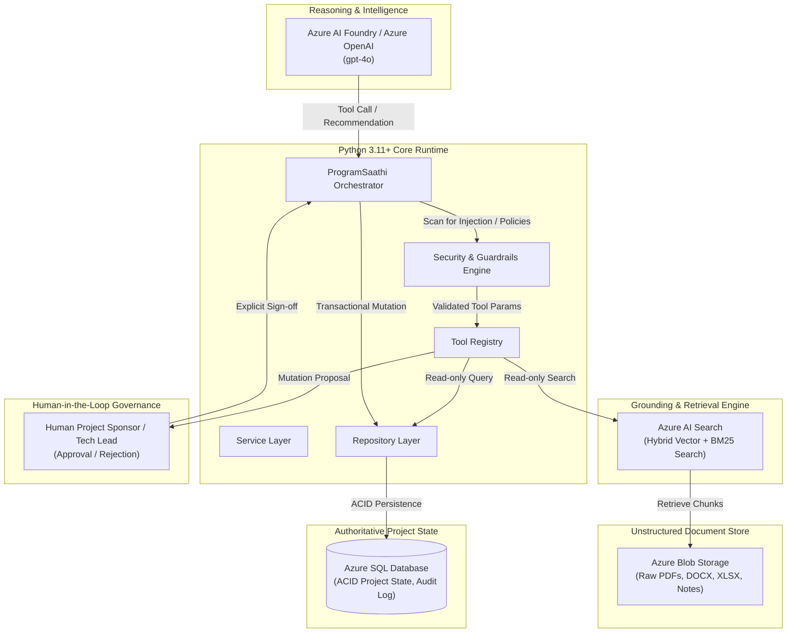
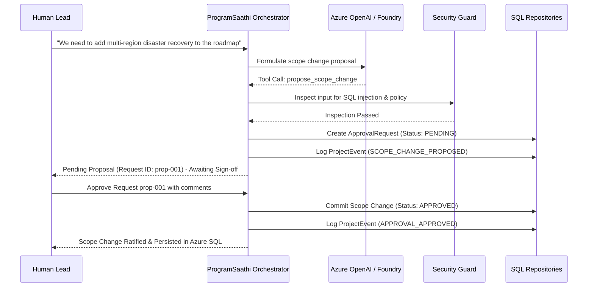

# ProgramSaathi — Technical Architecture Blueprint

## 1. System Vision & Purpose

**ProgramSaathi** is an agentic AI system engineered specifically for Enterprise Program and Project Management. Rather than operating as a chatbot or generic summarizer, ProgramSaathi functions as an active technical program management partner.

---

## 2. Architectural Boundaries & Non-Negotiables

### Critical Boundaries
1. **Azure OpenAI / Microsoft Foundry**: Reasoning, interpretation, synthesis, and tool selection.
2. **Azure Blob Storage**: Immutable storage for raw uploaded artifacts (PRDs, meeting transcripts, specs).
3. **Azure AI Search**: Retrievable document chunks, embeddings, hybrid keyword+vector index.
4. **Azure SQL**: Authoritative structured project state, work items, and immutable audit event stream.
5. **Python Core**: Orchestration, validation, security guardrails, business rules, tool dispatch.
6. **Human-in-the-Loop**: Absolute authority on consequential state mutations (scope changes, budget changes, roadmap commits).

---

## 3. Human-in-the-Loop State Mutation Cycle

---

## 4. Phase Plan

1. **Phase 1: Python Foundation & Domain Models** (Current)
2. **Phase 2: Configuration & Secret-Safe Environment** (Current)
3. **Phase 3: Azure Foundry / OpenAI Client Integration**
4. **Phase 4: Structured LLM Output Pipelines**
5. **Phase 5: Azure SQL Integration & Migrations**
6. **Phase 6: Blob Storage Document Lake**
7. **Phase 7: Document Extraction & Normalization**
8. **Phase 8: Azure AI Search Hybrid Indexing & RAG Retrieval**
9. **Phase 9: Project Intake Capability Workflow**
10. **Phase 10: Tool-Calling Agent Loop & Human Gate Execution**
